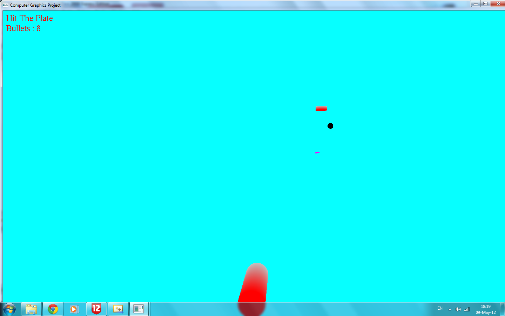

# Hit The Plate

A 3D shooting game in C++ with OpenGL and GLUT. Plates fly across the screen, and the
player aims a cannon and shoots them down.

This was the final project of a 3D computer-graphics course. The course supplied a basic
OpenGL skeleton (`CMyOpenGLInit`), and I built the geometry classes and the game on top of it.

## How to play

| Key | Action |
| --- | --- |
| 1 | Start the game (from the menu) |
| 2 | Show the instructions |
| 3 | Exit |
| S | Send in the plates |
| Arrow keys | Move the cannon and the aim |
| Space | Shoot |
| R | Restart after the game ends |

## Code structure

Each class is built from the one below it:

- `CPoint`: a 3D point with a color.
- `CPolygon`: a dynamically allocated array of points. `CSquare`, `CCircle` and `CBg` (the background) inherit from it.
- `CModel`: a dynamically allocated array of polygons, with move, rotate and scale operations. `CCube`, `CBall` and `CCylinder` inherit from it.
- `CGameHandler`: the game itself: setup, drawing each frame, game logic, on-screen text and keyboard input.

Some details worth noting:

- `CPolygon` and `CModel` manage their own memory with `new[]` and `delete[]`, and have copy constructors that make deep copies.
- Hits are detected with an axis-aligned bounding-box test: a bullet hits a plate when their centers are close enough on all three axes.
- Each plate is a flattened `CCylinder` that moves and spins every frame, and wraps around when it leaves the screen.

## Build

Windows with Visual Studio: open `Mission 5.sln`, build for Win32 and run.
GLUT is included in the repo (`glut.h`, `glut32.lib`, `glut32.dll`).

## What I would improve today

- Replace the raw arrays in `CPolygon` and `CModel` with `std::vector`. They define a copy constructor and a destructor but no assignment operator, so assigning one model to another would copy the pointer and free the same memory twice (the rule of three).
- Mark the destructors of the base classes `virtual`, since other classes inherit from them.

## Documents

- `docs/ספר פרוייקט - Hit The Plate.docx`: the project book (Hebrew).
- `docs/הוראות למשימת CGameHandler.pdf`: the course assignment for the game-handler stage (Hebrew).
